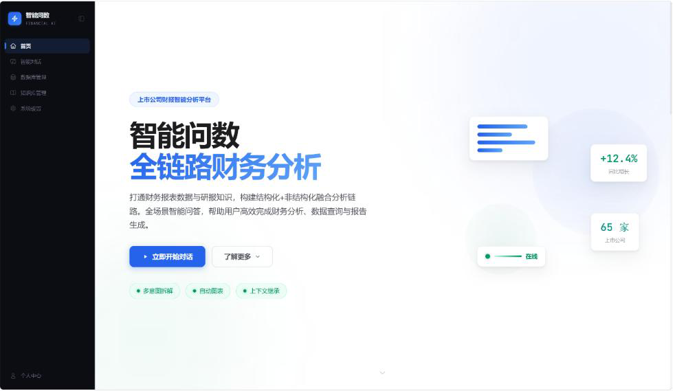
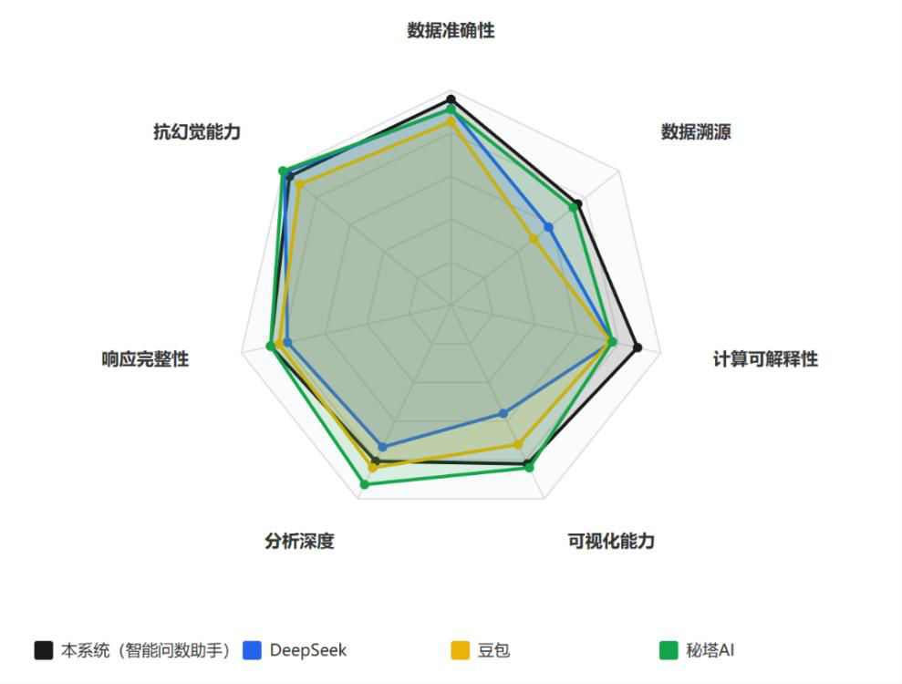
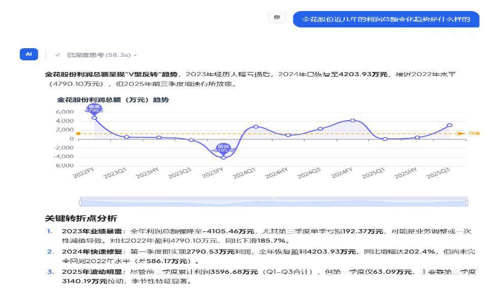
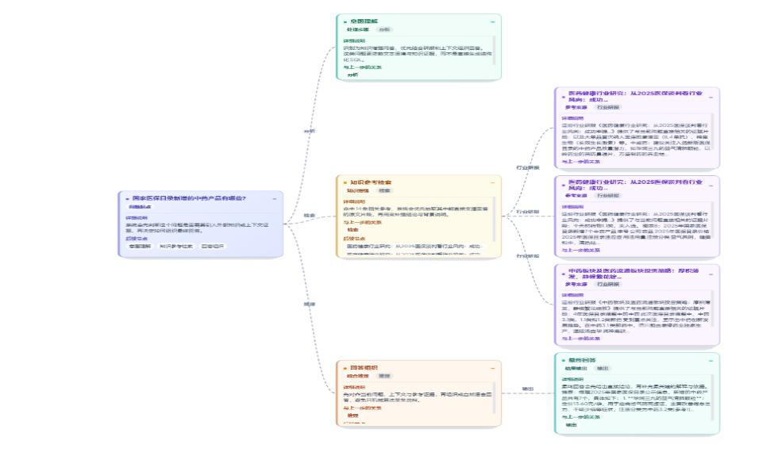
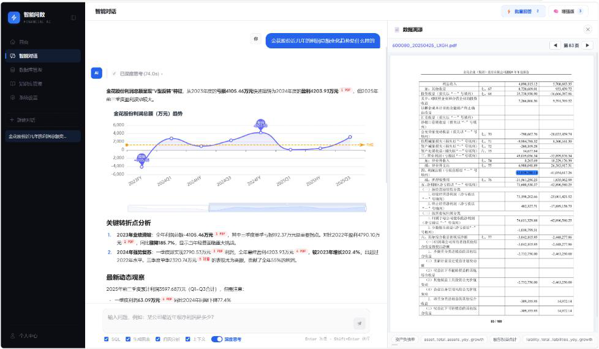
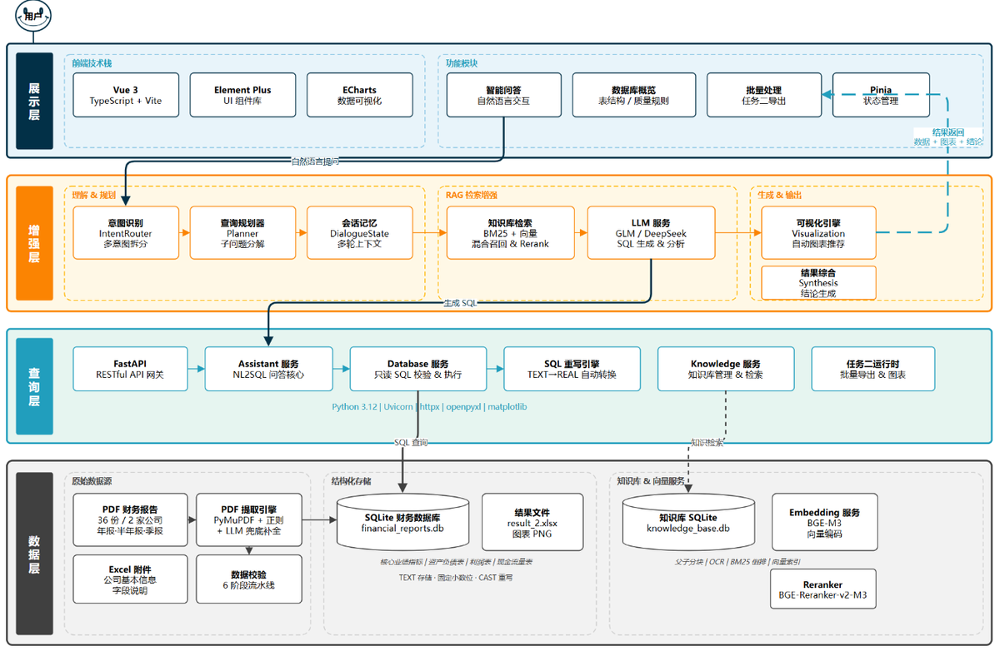

# Financial Report Q&A Assistant

**English** | [**中文**](README.md)

[](LICENSE)
[](https://github.com/liu380824/tipdm-b-financial-qa/stargazers)
[](requirements.txt)
[](api_server.py)
[](smart-query-ui/)
[](docs/赛题-B题-题目说明.md)

Current version **v1.0** · [Release notes](https://github.com/liu380824/tipdm-b-financial-qa/releases/tag/v1.0) · [All releases](https://github.com/liu380824/tipdm-b-financial-qa/releases)

A natural-language data-querying system for the financial reports of A-share
traditional-Chinese-medicine (TCM) listed companies. It connects the full chain:
**unstructured annual-report PDF → structured financial database → intent
understanding → SQL generation → data retrieval → visualisation → attribution
analysis**, with multi-turn dialogue, intent clarification, multi-intent
planning and result provenance.



<details>
<summary><b>Contents</b></summary>

- [Key results](#key-results)
- [Background](#background)
- [What the three tasks require, and how they are solved](#what-the-three-tasks-require-and-how-they-are-solved)
- [Architecture](#architecture)
- [Repository structure](#repository-structure)
- [Requirements](#requirements)
- [Quick start](#quick-start)
- [Evaluation](#evaluation)
- [Key parameters](#key-parameters)
- [Output artifacts](#output-artifacts)
- [Data and licensing](#data-and-licensing)
- [Troubleshooting](#troubleshooting)
- [License](#license)

</details>

## Key results

| Metric | Result |
|---|---|
| Average completeness of the core performance table | **96.3 / 100** |
| Average field-level provenance confidence | **0.82** (traceable to PDF page) |
| 7-dimension benchmark vs mainstream LLM products | **87.4, ranked 1st** (3 dimensions ranked 1st outright, 1 tied; Metaso AI 86.8, DeepSeek 78.1, Doubao 77.6) |
| Ablation | All enhancement components pass significance tests; disabling LLM-based deep analysis costs 24.2 points on average (Cohen's d ≥ 0.8) |
| Scale | 4 main tables × 824 rows, 70 companies, 13 reporting periods; knowledge base of 473 research reports and 34,435 semantic chunks |

Seven-dimension capability comparison:



Full experimental data: [`docs/实验结论.md`](docs/实验结论.md) (Chinese).

### Screenshots

| Knowledge-augmented Q&A | Reasoning trace (Thinking Map) | Field-level provenance |
|---|---|---|
|  |  |  |

> **You can understand this project without the competition dataset.** The official
> attachments are not redistributed, but the repository keeps the full set of real
> outputs: `docs/实验结论.md` (all experiment numbers), `quality_visual_reports/`
> (data-quality report), `result_2.xlsx` / `result_3.xlsx` (task answers) and
> `result/` (generated charts).

---

## Background

This is the complete implementation for **Track B: "Intelligent Data Querying"
Assistant for Listed-Company Financial Reports** of the *14th TipDM Cup Data Mining
Challenge (2026)*. It received the **1st Prize (National Undergraduate Group)** and was
shortlisted for the Grand Prize on-site defence.

Problem statement: [`docs/赛题-B题-题目说明.md`](docs/赛题-B题-题目说明.md) (Chinese),
also available as [PDF](docs/赛题-B题-题目说明.pdf).

---

## What the three tasks require, and how they are solved

| Task | Requirement | Implementation |
|---|---|---|
| **1. Build a structured financial database** | Extract performance data from unstructured PDFs into four main tables; run consistency checks before loading | `pdf_extractor.py` handles layout parsing and field extraction; `create_database.py` creates tables and records `field_provenance` / `import_issues`; `data_importer.py` imports and cross-validates; `quality_report.py` emits the data-quality report |
| **2. Build the Q&A assistant** | Natural language → intent → SQL → query → visualisation → conclusions, with multi-turn dialogue and clarification | Intent routing, dialogue state, SQL query layer and charting live in `backend/services/`; `backend/tasks/task2_runtime.py` runs the batch questions and exports `result_2.xlsx` |
| **3. Improve reliability** | Research-report knowledge base, multi-intent planning, attribution analysis, explainability | `backend/services/knowledge.py` builds the RAG knowledge base; `planner.py` / `llm_query_planner.py` decompose multi-intent queries; `*_tracer.py` record data and computation provenance; `task3_runtime.py` exports `result_3.xlsx` |

---

## Architecture

Four layers — data, query, enhancement, presentation — each with an independent
degradation path:



```
                    ┌──────────────────────────────────────────┐
   Unstructured  ──▶│  pdf_extractor.py   parse / extract       │
   inputs           │  data_importer.py   import + validate     │
   (reports PDFs)   │  create_database.py create 4 main tables  │
                    └───────────────────┬──────────────────────┘
                                        ▼
                    ┌──────────────────────────────────────────┐
                    │  SQLite financial DB + report vector KB   │
                    └───────────────────┬──────────────────────┘
                                        ▼
   User question ──▶┌──────────────────────────────────────────┐
                    │  intent routing                          │
                    │  multi-intent planning                   │
                    │  SQL generation & execution              │
                    │  KB retrieval (BM25 + vector + RRF)      │
                    │  rerank → synthesis → chart generation   │
                    │  provenance tracing                      │
                    └───────────────────┬──────────────────────┘
                                        ▼
                    FastAPI backend  ◀──▶  Vue 3 frontend
```

### Module responsibilities

| Module | Location | Responsibility |
|---|---|---|
| Data pipeline | root `*.py` | PDF parsing, field extraction, DB creation, import, quality report, KB build/compaction |
| Backend | `backend/` | FastAPI app: intent routing, dialogue state, SQL layer, knowledge base, visualisation, perf instrumentation |
| Frontend | `smart-query-ui/` | Vue 3 + Vite + TypeScript: Q&A workbench, database views, KB views, provenance and mind-map panels |
| Model benchmark | `benchmark/` | Multi-model comparison, response collection, ground-truth generation, scoring and HTML report |
| Ablation | `ablation/` | Component-by-component ablation of the 7 enhancement components |
| Outputs | `result/`, `result_2.xlsx`, `result_3.xlsx` | Generated charts and the required submission files |

---

## Repository structure

```
.
├── backend/                    # FastAPI backend
│   ├── app.py                  # entry point and routes
│   ├── core/                   # database, KB storage, data models, context
│   ├── services/               # intent, SQL, knowledge, visualisation, tracing
│   └── tasks/                  # batch runtimes for task 2 / task 3
├── smart-query-ui/             # Vue 3 frontend
├── benchmark/                  # model comparison, scoring, ground truth
├── ablation/                   # ablation experiments
├── docs/                       # problem statement, DB schema, experiment results, images
├── result/                     # generated charts (86 images)
├── quality_visual_reports/     # data-quality HTML report (sample output)
├── pdf_extractor.py            # PDF layout parsing and field extraction
├── data_importer.py            # import + consistency validation
├── create_database.py          # table creation
├── quality_report.py           # data-quality scoring and report
├── rebuild_kb.py               # rebuild the research-report knowledge base
├── compact_kb.py               # lossless KB compaction
├── api_server.py               # backend launcher
├── run_batch_export.py         # batch run task 2 / task 3
└── config.example.json         # configuration template
```

---

## Requirements

| Component | Version |
|---|---|
| Python | 3.11 |
| Node.js | 18+ (frontend build) |
| Main dependencies | fastapi 0.115, pydantic 2.10, uvicorn 0.34, httpx 0.28, PyMuPDF 1.25, pdfplumber, openpyxl 3.1, numpy 2.1, matplotlib 3.9, rank_bm25, jieba |
| Frontend | vue 3.5, element-plus 2.13, echarts 5.6, pinia 3.0, vite 6.4, typescript 5.6 |

### Optional dependencies

These three are not required for the main pipeline (the code degrades gracefully),
but some capabilities are reduced without them:

| Package | Purpose | Behaviour when missing |
|---|---|---|
| `rapidocr-onnxruntime` | OCR fallback for scanned PDFs | Scanned pages without a text layer cannot be extracted |
| `openai` | Collect third-party model responses in `benchmark/collect_responses.py` | That script prompts to install it; response collection unavailable |
| `psutil` | Process memory sampling in the performance benchmark | Falls back to Windows `ctypes` working-set reading; conclusions unaffected |

---

## Quick start

### 1. Install dependencies

```bash
python -m venv .venv
.venv/Scripts/activate          # Windows
pip install -r requirements.txt
```

### 2. Prepare data

The official competition data (attachments 1–7) is **not distributed with this
repository**. Obtain it from the competition organiser and place it anywhere locally.

### 3. Configure

```bash
cp config.example.json config.json
```

Edit `config.json` and fill in:

- `reports_dir`: directory of attachment 2 (financial reports)
- `research_reports_dir`: directory of attachment 5 (research reports)
- `embedding.api_key` / `llm.api_key` / `intent_llm.api_key` / `extract_llm.api_key`: API keys

> ⚠️ Never commit keys. `config.json` is excluded by `.gitignore`; the repository only
> ships `config.example.json`.

### 4. Create the database and import

```bash
python create_database.py       # create tables
python data_importer.py         # parse PDFs, import, run consistency checks
```

### 5. Data-quality validation

```bash
python quality_report.py --db-path financial_reports.db \
                         --output-dir quality_reports \
                         --visual-output-dir quality_visual_reports
```

The HTML report is written to `quality_visual_reports/`; one real run is kept in the repo.

### 6. Build the research-report knowledge base

```bash
python rebuild_kb.py            # full rebuild (ingestion + indexing)
python compact_kb.py            # lossless compaction
```

### 7. Run the system

```bash
# backend (default http://127.0.0.1:8000)
python api_server.py

# frontend
cd smart-query-ui
npm install
npm run dev
```

| Service | URL |
|---|---|
| Frontend | http://localhost:5173 |
| Backend API docs (Swagger) | http://127.0.0.1:8000/docs |

The frontend proxies `/api` and `/result` to the backend, so no extra CORS setup is needed.

### 8. Batch run and export

```bash
python run_batch_export.py      # task 2 (attachment 4) then task 3 (attachment 6)
python test_single_batch.py     # single-question debugging
```

Question file paths can be set via arguments or environment variables:

```bash
python run_batch_export.py --task2-file ./data/task2_questions.xlsx \
                           --task3-file ./data/task3_questions.xlsx
```

Outputs go to `result_2.xlsx` and `result_3.xlsx`; charts go to `result/`.

### 9. Reproduce the experiments

```bash
python -m benchmark.model_compare                  # base-model selection
python -m ablation.run_ablation -n 3 -r 3 --judge  # ablation study
python -m benchmark.run_benchmark                  # 7-dimension comparison
```

> `run_benchmark` requires manually filling in the responses of Doubao, DeepSeek and
> Metaso AI under `benchmark/llm_responses/*.json` (three samples are provided), then
> running it once to generate the comparison report.

---

## Evaluation

### Model comparison (`benchmark/`)

Compares GLM-4-Flash, DeepSeek-V3, Qwen2.5-72B-Instruct and GLM-5.1 on latency, answer
quality, cost and safety compliance. Produces an HTML report and a CSV score table.

### Ablation (`ablation/`)

Seven enhancement components are ablated one by one, with significance testing and
Cohen's d effect size reported for every component.

```bash
python -m ablation.run_ablation -n 3 -r 3 --judge
```

### 7-dimension comparison (`benchmark/run_benchmark.py`)

26 sub-items across 7 dimensions, 100 points total:
accuracy 30%, provenance 15%, analysis depth 15%, explainability 10%, visualisation 10%,
response completeness 10%, anti-hallucination 10%.

> The project ranks 1st overall (87.4). Per dimension, it ranks 1st outright in
> accuracy (28.7), provenance (11.3) and explainability (8.9), ties 1st in response
> completeness (8.6), and trails Metaso AI in visualisation (8.2 vs 8.4), analysis depth
> (12.1 vs 13.9) and anti-hallucination (9.6 vs 10.0).

---

## Key parameters

Retrieval and generation parameters live in the `knowledge_base` section of `config.json`:

| Parameter | Default | Description |
|---|---|---|
| `bm25_weight` / `vector_weight` | 0.3 / 0.7 | Fusion weights for sparse and dense retrieval |
| `rrf_k` | 60 | RRF fusion ranking parameter |
| `rerank_candidates` | 30 | Number of candidates passed to the reranker |
| `top_k` | 5 | Number of segments finally returned |
| `child_chunk_min` / `child_chunk_max` | 100 / 300 | Child chunk length |
| `parent_chunk_max` | 900 | Maximum parent chunk length (used for context backfill) |
| `ocr_dpi` / `ocr_workers` | 200 / 4 | DPI and concurrency for scanned-page OCR |

---

## Output artifacts

| File | Description |
|---|---|
| `result/*.jpg` | Charts generated by the assistant, named `{question_id}_{index}` as required by the task |
| `result_2.xlsx` | Task 2 answer submission (matches attachment 7, table 3) |
| `result_3.xlsx` | Task 3 answer submission (matches attachment 7, table 6) |
| `quality_visual_reports/` | Data-quality visualisation report (HTML + SVG charts) |
| `benchmark/model_compare_results/` | Raw model-comparison results, score CSV and HTML report |
| `ablation/ablation_results_*.json` | Raw results of each ablation run |

---

## Data and licensing

- Competition data (attachments 1–7) is © the competition organiser and is **not**
  redistributed here.
- The repository contains no API keys, credentials or personal information.
- Code is released under the MIT License; see [LICENSE](LICENSE).

## Troubleshooting

| Symptom | Cause and fix |
|---|---|
| `FileNotFoundError: config.json` | Config not created from the template. Run `cp config.example.json config.json`, then fill in paths and keys |
| Every script fails on keys at startup | All four `api_key` fields must be filled: embedding / llm / intent_llm / extract_llm |
| Nothing extracted from a report PDF | Likely a scanned file without a text layer. Install the optional dependency `pip install rapidocr-onnxruntime` to enable the OCR fallback |
| `python -m benchmark.model_compare` reports empty keys | Set the `SILICONFLOW_API_KEY` and `BIGMODEL_API_KEY` environment variables |
| Frontend will not open, or API requests fail | The backend must be started first (`python api_server.py`, default 127.0.0.1:8000); both must run together |
| Database file is very large | Expected. Build artifacts (`*.db`) are excluded by `.gitignore` and never committed |
| Want to switch models | Use the in-app system settings page to switch at runtime, or edit `config.json` and restart |

---

## License

MIT
